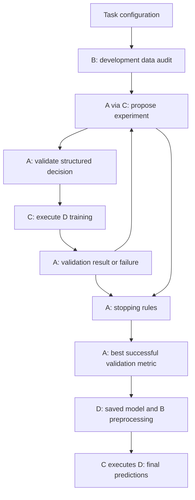

# Part A — Autonomous orchestration

**Current API setup:** the user's key belongs to HKUST HPC AIGC, not Diandong Cloud. A live call succeeded on 2026-11-22. Use `parta/configs/hkust.env.example`; see [verified school endpoint, model and usage](HKUST_API_ZH.md). Older Diandong setup notes are historical.

**Live acceptance:** both released tasks completed on 2026-11-22; 142 tests passed. [Results, downloadable model bundles and B/C/D review checklist](LIVE_RESULTS_ZH.md).

**2026-11-27 review follow-up:** [Planner contract/error feedback repair, 184 passing tests, a new autonomous Headlines run and per-call ledger reconciliation](../PLANNER_FEEDBACK_AND_LEDGER_20261127_ZH.md). The November 22 artifacts remain historical evidence for their original source version.

Run commands from the repository root with **CPython 3.11.5** for saved-model reproduction. See [locked environment instructions](../ENVIRONMENT.md). Install B/C/D into the same interpreter used by the executor:

```powershell
python -m venv .venv
.\.venv\Scripts\python.exe -m pip install -r requirements.lock
.\.venv\Scripts\python.exe -m pip install --no-build-isolation -r requirements.txt
.\.venv\Scripts\python.exe scripts/check_environment.py
```

## Offline acceptance

```powershell
.\.venv\Scripts\python.exe run_superagent.py demo --output runs/demo-tabular --modality tabular
.\.venv\Scripts\python.exe run_superagent.py demo --output runs/demo-text --modality text
$env:PARTB_ROOT = (Resolve-Path partb).Path
$env:PARTC_ROOT = (Resolve-Path partc).Path
New-Item -ItemType Directory -Force runs | Out-Null
.\.venv\Scripts\python.exe -m pytest parta/tests partb/tests partc/tests partd/tests --import-mode=importlib --basetemp=runs/tests -q -o addopts=
```

The pytest base directory is disposable test output and is cleared by pytest on rerun.
Keep it separate from experiment results. On restricted Windows sandboxes, taskkill
may fail with an authentication error; the process-tree test requires an environment
that allows termination of the test's own child processes.

Demo directories must be new. The demo planner is explicitly deterministic/offline and incurs no LLM usage. Training, validation, subprocess execution, persistence and prediction use real B/C/D code. Test labels deliberately contain invalid sentinels to catch accidental label loading. These are not official experiments.

## Live run

Copy `parta/configs/task.example.json` and set data_config to a B configuration and data_root to the instructor dataset. Paths resolve relative to the task JSON. Use stable task_id and one shared output_root for the budget ledger; each run_id must be new. Do not delete or relocate the ledger to reset a task's spending. Run one process at a time: C's ledger is not a concurrent accounting service.

Provide AIAA3102_API_KEY (preferred; ZZZ_API_KEY remains supported), ZZZ_BASE_URL and ZZZ_MODEL in environment variables or an ignored `.env`. Both key variables are removed from training subprocess environments. Do not commit credentials. The selected model must pass C's registry checks, and its pricing/version evidence needs review before official use.

```powershell
.\.venv\Scripts\python.exe run_superagent.py run --config parta/configs/task.example.json --env-file .env
```

If the key was saved as a Windows user environment variable after starting the terminal,
refresh only that variable before running (this command does not print it):

```powershell
$env:AIAA3102_API_KEY = [Environment]::GetEnvironmentVariable('AIAA3102_API_KEY', 'User')
```

Options: max_steps bounds LLM planning calls; patience bounds consecutive failed/non-improving steps; execution_timeout applies per training/prediction subprocess; max_tokens limits planning output. budget_rmb must be >0 and <=20, and must match an existing ledger for the same task. C accounting accumulates across run IDs. Unknown usage/provider failures stop calls; internal network retries are disabled to avoid unrecorded attempts.

## Flow and boundaries



A generates configuration rather than arbitrary executable Python. Only model and preprocessing choices are mutable; the metric, splits, paths, task identity and budget remain fixed. Selection maximizes/minimizes the configured metric, with the first candidate winning ties. Test input loading occurs only after selection; test scores never enter planning. With `final_evaluation: true`, test accuracy is computed once after successful final prediction, using B's explicit final-evaluation gate and checking sample IDs/order. It defaults to false.

Malformed/duplicate plans and training errors become next-step feedback. Budget refusal or uncertain usage stops planning immediately. With a successful candidate, the best available model is exported even if planning stops early. No successful candidate yields `failed`; a valid model with failed prediction yields `partial`; completed export/prediction yields `success`. CLI exit code is 0 only for success, otherwise 2.

## Run artifacts

Under output_root/task_id/run_id:

- config.json, data_audit.json: resolved configuration and development audit.
- decisions.jsonl: planner responses, decisions, feedback and locked final selection.
- requests/, results/, execution/: exact experiment requests, responses and subprocess logs. Candidate artifacts live under output_root/artifacts/task_id/run_id to avoid duplicating path segments on Windows.
- llm_logs/: C call logs, including actual tokens and costs for live runs.
- state.json: latest completed experiment history and best candidate; a checkpoint for inspection, not automatic resume.
- selection.json, final_model/: selected candidate and complete copied model/preprocessing bundle.
- prediction_result.json, predictions.csv: final prediction status and output.
- final_evaluation.json: optional test accuracy, computed after selection and prediction only.
- summary.json: final status, stop reason, selected result, budget and source fingerprint.

Existing run directories are rejected. Successful live execution is not automatically labeled an official result: dataset rules, output format and pricing evidence require verification. The source hash captures working source, including uncommitted integration changes.

Independent prediction (same environment and B source version):

```powershell
.\.venv\Scripts\python.exe -m partd predict --artifact <run-directory>/final_model --data-root <dataset-directory> --output <new-predictions.csv>
```

## Limitations

Image training is unsupported by current D and fails explicitly before search. Candidate algorithms are logistic regression and random forest. No arbitrary generated-code sandbox, automatic resume, parallel runs, final full-data retraining or official output-format customization is claimed. The UTF-8 reservation estimate is conservative, not an exact provider tokenizer. The school model mapping and current pricing were checked; dated October 21 pricing evidence still needs team confirmation. See HKUST_API_ZH.md and VERIFICATION.md.

AI assistance: Part A implementation, integration review, tests and documentation were developed with Codex assistance. Team members must review and understand these changes and incorporate this disclosure in their shared AI usage statement.

## Released datasets and historical platform notes

Both instructor datasets have completed live runs. Task configs reference the existing extracted folders without copying raw data into Git. [Earlier Diandong investigation](DATA_AND_DIANDONG_ZH.md) is historical; use the school HPC endpoint documented above. Existing run directories cannot be overwritten: for a new autonomous run, set a new run_id while keeping task_id, output_root and the persistent budget ledger unchanged.
